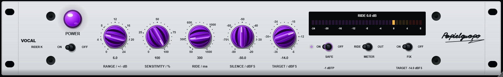

# Vocal Rider K 1.3.0 — Windows x64

[Descargar VST3 y Standalone](https://github.com/papielguapo/Vocal-Rider-K/releases/latest)

Nivelador vocal con RANGE, SENSITIVITY, RIDE, SILENCE y TARGET. El objetivo de volumen es ajustable e independiente de la escala K del medidor. La escala K es una referencia de lectura; no es un nivel obligatorio para voces de un género.

## Instalación y tamaño

Cierra el DAW y copia la carpeta completa `Binaries/Vocal Rider K.vst3` a `C:\Program Files\Common Files\VST3`. Reescanea y reabre el plugin. No copies solo el binario interior. La aplicación Standalone está en Binaries.

Abre siempre a 817 × 126 px. Se puede ampliar hasta 4085 × 630 px, con la misma proporción y límites que FET 67. Arrastra la esquina inferior derecha.

## Controles

| Control | Función |
|---|---|
| RANGE | Corrección máxima simétrica, 0–24 dB. Inicial: ±6 dB. |
| SENSITIVITY | 100% busca TARGET con precisión; 0% permite ±3 dB de tolerancia. 50% permite ±1.5 dB. Inicial: 100%. |
| RIDE | Suavizado, 50–1500 ms. El recorte usa 0.5× el valor y la subida 1.5×; el detector RMS añade su respuesta de 300 ms. Inicial: 300 ms. |
| SILENCE | Umbral de detección, −80 a −20 dBFS. Evita perseguir señales demasiado bajas; no corta el audio. Inicial: −50 dBFS. |
| TARGET | Nivel medio vocal deseado, −36 a −6 dBFS RMS calibrado con senoide. Inicial: −14 dBFS. |
| SAFE | A la izquierda de RIDE/OUT. Protección de picos, activada inicialmente. LED morado indica activación y brilla más al atenuar. |
| RIDE / OUT | Muestra corrección aplicada o nivel RMS de salida relativo a la escala K seleccionada. |
| FIX | A la derecha: activa la nivelación automática hacia TARGET. Apagado desactiva el rider, aunque SAFE puede seguir limitando. |
| POWER | Desactiva el procesamiento y conserva la latencia reportada al host. |

Doble clic en el número bajo una perilla para escribirlo. Enter aplica; Escape cancela. Admite coma decimal y unidades (dB, %, ms, dBFS). Se limitan los valores fuera de rango y se rechazan entradas inválidas/no finitas. Doble clic sobre el mando restaura su valor inicial.

## Escala K desde el medidor

Haz **clic derecho sobre el medidor** y elige K-12, K-14 o K-20. Esta selección solo modifica la lectura: **no cambia el objetivo, la ganancia ni el sonido**. Se guarda con la sesión y sigue disponible como parámetro del host.

Ejemplo: TARGET −18 dBFS equivale a una lectura de −6 K en K-12, −4 K en K-14 y +2 K en K-20. Es la misma señal con escalas diferentes. El encabezado OUTPUT muestra la escala activa.

El detector usa RMS con +3.0103 dB de calibración senoidal, no LUFS ni ponderación K de BS.1770. Una senoide con pico −14 dBFS lee −14 dBFS en este detector. En estéreo se promedia la energía de los canales y se aplica la misma ganancia a ambos. El sistema K original también contempla calibración de monitores: este plugin no calibra tus altavoces. [Referencia de Bob Katz](https://www.digido.com/portfolio-item/level-practices-part-2/).

## Sidechain musical

Conecta el instrumental, sin la voz, al bus auxiliar **Sidechain** (mono o estéreo). No añade controles a la skin. Sin conexión, el objetivo es TARGET fijo. Con música audible aprende una referencia en unos 1.5 segundos y desplaza el objetivo hasta ±6 dB respecto a TARGET siguiendo los cambios sostenidos de nivel. RANGE sigue limitando la corrección y SENSITIVITY su tolerancia.

Ante silencio/desconexión vuelve suavemente a TARGET. El instrumental solo se analiza; no se mezcla con la salida vocal. La referencia aprendida se reinicia al preparar/reiniciar el procesador o desconectar el bus y no se guarda en presets. No añade latencia.

En FL Studio, envía el instrumental a la pista de voz mediante **Sidechain to this track** y asigna la entrada auxiliar en **Processing → Connections** del wrapper. Mantén la voz como entrada principal. [Manual oficial](https://www.image-line.com/fl-studio-learning/fl-studio-online-manual/html/plugins/wrapper.htm).

## SAFE y límites

SAFE estima picos entre muestras con un FIR de 65 taps a 8x. Protección de −1 dBTP con un margen interno conservador de 1.2 dB (nivel interno −2.2 dBFS); puede actuar antes del techo. Latencia fija `ceil(0.003 × sampleRate) + 96` muestras, 240 muestras / 5 ms a 48 kHz, incluso con SAFE apagado. Se reporta al host para PDC. Recuperación aproximada: 80 ms. El audio se mantiene a la frecuencia de muestreo original.

TARGET es un objetivo medio, sujeto a RANGE, SENSITIVITY, SILENCE, tiempos de respuesta y SAFE. Si SAFE limita, los picos tienen prioridad. El medidor principal es RMS, no true peak. El plugin no clasifica voz frente a respiraciones/ruido y no escribe curvas en la automatización del DAW.

## Presets anteriores

Al cargar un estado sin TARGET, se transforma la antigua referencia K en un objetivo absoluto: K-12 → −12, K-14 → −14, K-20 → −20 dBFS. Los antiguos límites boost/cut se convierten en RANGE usando el menor y SENSITIVITY 100%. Revisa automatizaciones antiguas: K ahora modifica únicamente el medidor; si quieres mover el nivel, automatiza TARGET.

## Compilación y validación

C++17, CMake ≥3.22, Visual Studio y JUCE. Configura `Rider_JUCE_PATH` si no está en C:/JUCE. Compila Release x64; `Rider_BUILD_TESTS=ON` habilita pruebas de audio y edición numérica. La instalación automática al compilar está desactivada. Informes en Validation.

JUCE usa AGPLv3 o licencia comercial. Según el uso y distribución puede ser necesaria una licencia comercial de JUCE. Se incluye JUCE-LICENSE.md.
